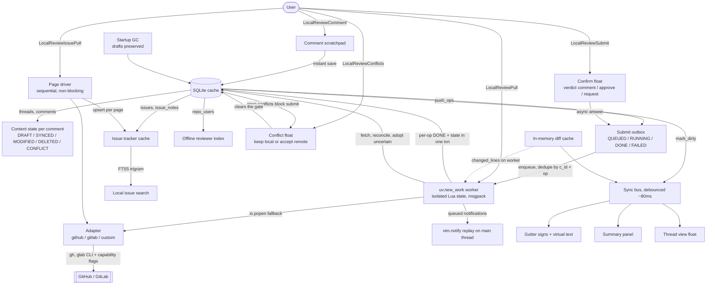
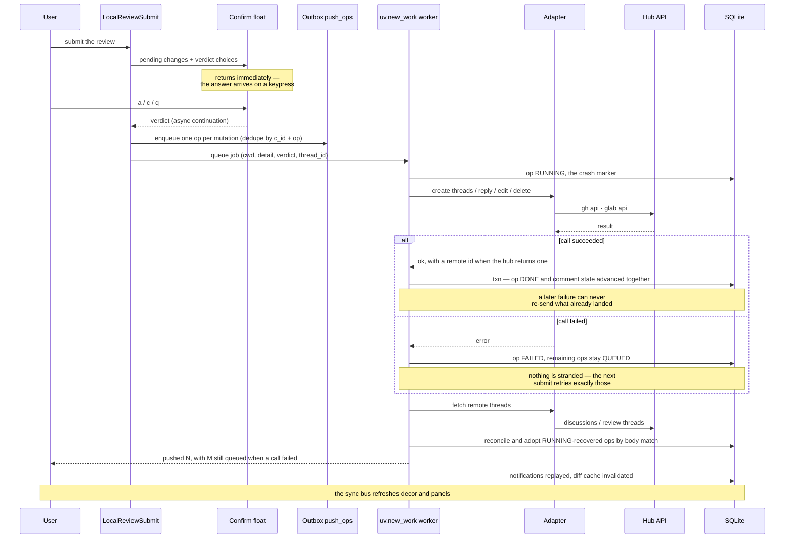
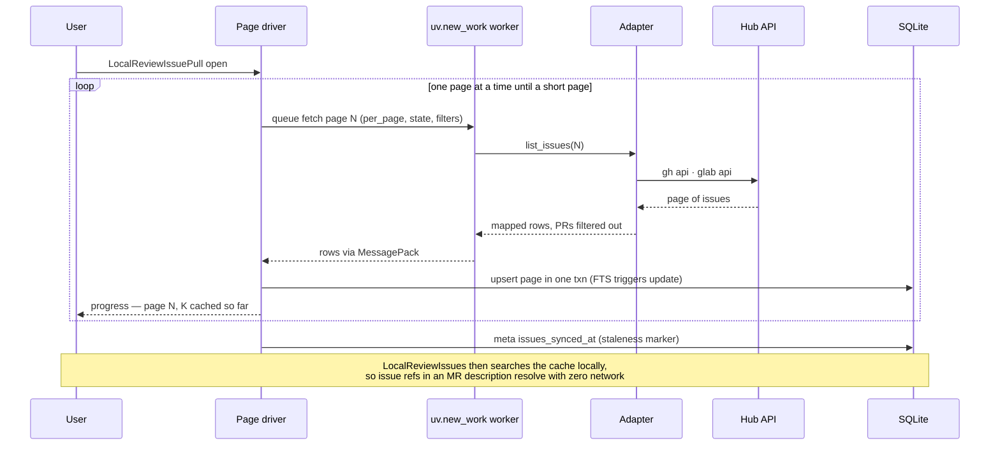

# lreview.nvim 💬

A unified, offline-first, non-invasive Merge/Pull Request code review plugin for Neovim. Review changes locally across GitHub and GitLab using a local SQLite cache.

> ## ⚠️ Warning — Experimental Plugin
>
> **This plugin is still experimental and under active development.**
>
> - Do **not** use this as your primary review tool yet.
> - The API, commands, configuration, and storage format may change or break
>   without notice between versions.
> - There are a bunch of **performance issues** and **likely bugs** along the
>   way that may trigger **unexpected conditions**.
> - Bugs and data-loss edge cases are possible. Use it **at your own risk**.
>
> If you do try it, prefer testing against a **throwaway repository** or a
> **non-critical branch** before relying on it for real reviews.



### Submit flow (outbox-backed, idempotent)



### Issue pull (sequential pages, never blocks the UI)




## Features

- **Offline-First Workflow:** Save draft comments locally instantly; publish them all in a single batch once you finish the review.
- **Sign + Floating Window Review UI:** A gutter sign (`💬` / `●` / `✔`) plus an EOL preview (`@author: "…" (+N replies)`) marks commented lines without shifting the code. `K` opens the thread view as a cursor-anchored float; `r` inside it opens a stacked reply float beneath, so the conversation stays visible while you type. Zero layout shift, real markdown rendering, no `virt_lines` crowding.
- **Idempotent Submit (outbox):** every pending mutation is one `push_ops` row. Each row is committed the moment its call succeeds, so a half-failed submit never re-posts what already landed, and nothing can be stranded in a state you cannot push. Re-run `:LocalReviewSubmit` to retry exactly what is left.
- **Asynchronous Engine:** Background pulling and pushing run on `uv.new_work` worker threads, so Neovim never freezes on a network request. Issue lists are paged sequentially with progress, also off the UI thread.
- **Unified Adapter Structure:** Handles both GitLab Merge Requests and GitHub Pull Requests with a single unified set of commands and UI. Platform differences that cannot be abstracted (batch vs per-note creation, verdict delivery) are declared as adapter capability flags rather than guessed.
- **Issue Tracker Context:** GitHub/GitLab issues are cached locally with FTS5 search, so you can see what an MR is actually *about* (`:LocalReviewIssues`, `:LocalReviewIssue 42`) without leaving the editor — and an MR description's `#123` references resolve from cache with zero network.
- **Conflict Awareness:** If the hub edits a comment you are editing, submit is blocked and `:LocalReviewConflicts` shows your version against the remote's so you can keep or accept it.
- **Auto-Garbage Collection:** Keeps the SQLite cache clean by purging old closed/merged reviews after 30 days while safeguarding your local drafts.
- **Dynamic Context Resolution:** Handles forks, nested subgroups (GitLab), and multiple concurrent repositories seamlessly in a single database.

---

## Requirements

- Neovim `0.10+`
- `sqlite3` installed on your system
- [sqlite.lua](https://github.com/kkharji/sqlite.lua) dependency
- Platform CLIs configured and authenticated:
  - `gh` CLI (for GitHub)
  - `glab` CLI (for GitLab)

---

## Installation

Using [lazy.nvim](https://github.com/folke/lazy.nvim):

```lua
{
  "zerosign/lreview.nvim",
  dependencies = {
    "kkharji/sqlite.lua",
  },
  rocks = { "lsqlite3" },
  opts = {
    defaults = {
      db_path = vim.fn.stdpath("data") .. "/lreview/lreview.db",
      ui = {
        decor = "both", -- "both" | "sign" | "virtual_text" | "none"
        layout = "float", -- "float" | "split" | "vsplit" | "buffer"
      },
    },
    ["github\\.com"] = {
      adapter = "github",
      provider = "gh",
      host = "github.com",
    },
    ["gitlab\\.com|gitlab\\..*"] = {
      adapter = "gitlab",
      provider = "glab",
      host = "gitlab.com",
    },
  },
  config = function(_, opts)
    require("lreview").setup(opts)
  end,
  keys = {
    { "<leader>oq",  "<cmd>LocalReviewQuery<cr>",   desc = "List PRs/MRs" },
    { "<leader>ot", "<cmd>LocalReviewToggle<cr>",   desc = "Toggle Review" },
    { "<leader>op", "<cmd>LocalReviewPull<cr>",    desc = "Pull/Sync Review Comments" },
    { "<leader>os", "<cmd>LocalReviewSubmit<cr>",  desc = "Submit PR Review" },
    { "<leader>od", "<cmd>LocalReviewSummary<cr>", desc = "View Review Summary Panel" },
    { "<leader>oA", "<cmd>LocalReviewApprove<cr>", desc = "Approve MR/PR" },
    { "<leader>oC", "<cmd>LocalReviewClose<cr>",   desc = "Close MR/PR" },
    { "<leader>on", "<cmd>LocalReviewCreate<cr>",  desc = "Create MR/PR" },
    { "<leader>oc",  ":LocalReviewComment<cr>",     mode = "x", desc = "Add inline review comment" },
  },
}
```

---

## Usage Workflow

### 1. Enable Review Highlights
Run `:LocalReviewToggle` (or press `<leader>ot`) in a repository. The plugin automatically and lazily resolves the git branch target MR/PR, queries the API, opens the SQLite database, and syncs all remote discussions to SQLite under the hood. Lines with discussions get a gutter sign (`💬` draft / `●` synced / `✔` resolved) and an EOL preview (`@author: "…" (+N replies)`).

### 2. Browse & Annotate code
* **View Comments:** Place the cursor on a marked line and press `K` (or run `:LocalReviewOpen` / `:LocalReviewHover`) to open the thread view. Enable `ui.hover_open = true` in setup opts if you want passive hover-open on `CursorHold`.
* **Add a Comment:** Make a visual selection of code lines and run `:LocalReviewComment` (or press `<leader>oc`). Write your comment and save with `:w` or `<C-s>` — it's cached as a local draft instantly, no network round-trip.

### 3. Manage Conversations (Sign + Floating Window)
Pressing `K` opens the thread view as a **floating window anchored to the cursor line** (or a bottom split when `ui.layout = "split"`). Inside that window, these buffer-local keys apply:

| Key | Action |
|:----|:-------|
| `r` | Reply — opens a **stacked reply float** docked beneath the thread window; type, then `<C-s>` (or `<CR>`) to save as a local draft. `@mention` and `!`/`#` MR-PR link completion are active while typing; `<C-g>` inserts a `suggestion` block from the thread's code range. |
| `e` | Edit your local draft comment (opens the scratchpad). |
| `d` | Delete your local draft comment (or mark a synced one for deletion). |
| `s` | Toggle Resolved / Reopened on the remote (async). |
| `P` | Push all pending drafts (equivalent to `:LocalReviewSubmit`). |
| `q` / `<esc>` | Close the thread view. |

The reply float stays clear of the code: nothing below the commented line shifts, and multi-line replies auto-grow the input box (4 → 12 rows).

### 4. Submit Staged Drafts
Once you finish your review, run `:LocalReviewSubmit` (or `<leader>os`) to batch push all local drafts to the remote platform. Every mutation is one `push_ops` row; a partial failure leaves the unpushed ones queued and safely re-runnable.

---

## User Commands

| Command | Description |
| :--- | :--- |
| `:LocalReviewQuery [scope]` | Query and list active MRs for this repository (`mine` or `all`). |
| `:LocalReviewStart` | Resolve the MR/PR for the current branch and start a review session (non-blocking). |
| `:LocalReviewDetail [number]` | Open/edit metadata and description for a specific MR/PR. |
| `:LocalReviewToggle` | Toggle buffer review signs and virtual text annotations. |
| `:LocalReviewComment` | Add an inline draft comment for the visual selection (instant, local). |
| `:LocalReviewSubmit` | Push all pending drafts, edits, and deletions via the outbox. |
| `:LocalReviewPull` | Sync the latest remote discussions into the local cache. |
| `:LocalReviewOpen` / `:LocalReviewHover` | Show the thread at the cursor in a float. |
| `:LocalReviewNext` / `:LocalReviewPrev` | Jump to the next/previous comment thread in the buffer. |
| `:LocalReviewSummary` | Open the interactive review summary panel (`g` toggles Threads/Files). |
| `:LocalReviewConflicts` | List blocked conflicts with your version vs. the remote; `k` keeps yours, `a` accepts theirs. |
| `:LocalReviewApprove` / `:LocalReviewClose` | Approve or close the active MR/PR. |
| `:LocalReviewCreate` | Create a new MR/PR using template and branch pickers. |
| `:LocalReviewRequestReview` | Request a review from a cached repo user (offline-first picker). |
| `:LocalReviewBranch <name>` | Materialize a branch locally (checkout or worktree per topology config). |
| `:LocalReviewPullUser` | Cache the repository's user list for reviewer autocomplete. |
| `:LocalReviewPullRequest` | Cache the open MR/PR list for link autocomplete. |
| `:LocalReviewIssuePull [state]` | Pull the issue list page by page (sequential, progress reported, UI never blocked). |
| `:LocalReviewIssues [state]` | Pick a cached issue (`open`/`closed`/`all`) and view it; refreshes when stale. |
| `:LocalReviewIssue <number>` | View one issue by number, pulling it from the hub only if uncached. |

---

## Configuration Options

Pass these options inside the `setup()` block to customize behaviors:

```lua
require("lreview").setup({
  defaults = {
    db_path = vim.fn.stdpath("data") .. "/lreview/lreview.db",
    db = {
      busy_timeout_ms = 5000,
      keep_days = 30, -- Garbage collect reviews older than 30 days
    },
    ui = {
      decor = "both", -- "sign" | "virtual_text" | "both" | "none"
      layout = "float", -- thread view surface: "float" | "split" | "vsplit" | "buffer"
      reply_layout = "stacked", -- reply surface: "stacked" | "scratchpad"
      hover_open = false, -- auto-open thread view on CursorHold
      float = {
        border = "rounded",
        width = 0.5, -- Floating window width (fraction of editor if <=1, else cells)
        height = 0.6, -- Floating window height (fraction of editor if <=1, else cells)
      },
      split = {
        position = "botright",
        size = 15,
      }
    },
    open = { method = "checkout" },
    -- Issue tracker cache: the context an MR description usually points at.
    issues = {
      per_page = 50,        -- hub page size for the sequential issue pull
      max_pages = 20,       -- hard stop, so a huge tracker cannot run away
      stale_after_min = 30, -- :LocalReviewIssues refreshes the cache past this age
    },
  }
})
```

---

## Gutter Line Highlights & Customization

The plugin highlights gutter line numbers and signs to represent review statuses and code changes, plus an EOL `virt_text` preview. These are linked to standard Vim groups by default so they match your theme automatically, but you can override them in your configuration:

* `LReviewSignDraft` (Default: `WarningMsg` link) - Sign column indicator for draft comment threads.
* `LReviewSignSynced` (Default: `Comment` link) - Sign column indicator for active remote threads.
* `LReviewVirtTextDraft` (Default: `WarningMsg` link) - EOL preview color when a thread contains drafts.
* `LReviewVirtTextSynced` (Default: `Comment` link) - EOL preview color for synced threads.
* `LReviewNumDraft` (Default: `DiffChange` link) - Gutter line number background highlight for drafts.
* `LReviewNumSynced` (Default: `DiffAdd` link) - Gutter line number background highlight for active threads.
* `LReviewNumResolved` (Default: `Comment` link) - Gutter line number background highlight for resolved threads.
* `LReviewDiffAdd` (Default: `DiffAdd` link) - Gutter line number background highlight for git diff changes.

The EOL preview itself renders in three shapes:

| Line has | Preview shows |
|---|---|
| One thread | `@<author>: "<first-comment snippet, 45 chars>" (+N replies) (M draft) (Resolved)` |
| Multiple threads | `N threads (M comments) (+R replies)` |
| Fully resolved | Preview dims to the `Comment` group and gains a `(Resolved)` suffix |

---

## Adding Custom Platform Adapters (Backends)

`lreview.nvim` is fully extensible. You can add support for other hosting platforms (e.g. Gitea, Sourcehut, or custom internal systems) by defining a custom adapter module and registering it through the `opts` setup without changing any plugin code:

1. **Create your custom adapter file** (e.g. `lua/my_adapters/gitea.lua`). These are the signatures the engine calls today — the argument *order* is part of the contract (a batch submit once passed a comment body where a remote id belonged, which 404'd and crashed):

   ```lua
   local M = {}
   M.name = "gitea"          -- canonical provider key used in stored ids
   M.provider = "gitea-cli"  -- CLI binary the ops shell out to

   -- Required: discovery + fetching
   function M.list_pull_requests(cfg, ctx, opts) end            -- opts.scope = "mine"|"all"
   function M.get_mr_detail(cfg, ctx) end                       -- ctx.ref = number|branch
   function M.get_mr_by_branch(cfg, ctx, branch) end
   function M.fetch_threads(cfg, ctx, number, mo_id) end        -- -> lreview.Thread[]

   -- Required: the mutation surface used by submit (storage/outbox.lua drives these)
   function M.submit_inline_review(cfg, ctx, number, comments, body, opts) end -- -> ok, err
   function M.submit_reply(cfg, ctx, number, thread_id, body) end               -- -> remote_comment_id, err
   function M.update_comment(cfg, ctx, number, thread_id, comment_id, body) end -- -> ok, err
   function M.delete_comment(cfg, ctx, number, thread_id, comment_id) end       -- -> ok, err
   function M.resolve_thread(cfg, ctx, number, thread_id, resolved) end         -- -> ok, err

   -- Optional, each gated by a capability flag (see the table below)
   function M.submit_verdict(cfg, ctx, number, verdict, body) end   -- review_verdict
   function M.approve_mr(cfg, ctx, number) end                       -- approve_mr
   function M.close_mr(cfg, ctx, number) end                          -- close_mr
   function M.update_mr(cfg, ctx, number, title, body) end            -- update_mr
   function M.create_mr(cfg, ctx, opts) end                           -- draft_mr
   function M.list_templates(cfg, ctx) end                            -- list_templates
   function M.list_users(cfg, ctx) end                                -- assign_reviewers
   function M.assign_reviewers(cfg, ctx, number, reviewers) end        -- assign_reviewers
   function M.list_issues(cfg, ctx, opts) end                         -- issues
   function M.get_issue(cfg, ctx, number) end                         -- issues
   function M.fetch_issue_notes(cfg, ctx, number, opts) end            -- issues

   M.capabilities = { issues = true }   -- anything unset falls back to the base defaults
   return M
   ```

   Any method you do not implement is simply skipped — but declare the capability
   only if you implement it. `review_verdict` with no `submit_verdict` is reported
   as a failed op rather than silently dropping your approve.

2. **Declare how your hub's submit behaves.** These three flags decide the shape of
   the network calls, and getting them wrong is what causes duplicate or dropped posts:

   | Capability | Meaning | GitHub | GitLab |
   | :--- | :--- | :--- | :--- |
   | `batch_submit` | can create several inline comments in one call | `true` | `false` |
   | `atomic_inline_batch` | that call is all-or-nothing, so nothing partially lands | `true` | `false` |
   | `verdict_in_review_batch` | the review event can ride along with that call | `true` | `false` |

   Anything unset inherits `adapter/base.lua` defaults (`atomic_inline_batch`
   false), which makes the engine loop per-op and commit each success
   individually — always the safe assumption for a hub you have not profiled.

3. **Register it in your configuration:**
   ```lua
   opts = {
     ["gitea\\.mycompany\\.com"] = {
       adapter = "my_adapters.gitea", -- Dynamically required on remote host match
       provider = "gitea-cli",
       host = "gitea.mycompany.com",
     }
   }
   ```

---

## Performance & Caching Details

- **SQLite Engine Compatibility (Flavors):** The storage layer dynamically binds to the system `libsqlite3.so` library using **LuaJIT FFI** (Foreign Function Interface) for native C execution speed and zero-overhead Neovim startup. If LuaJIT FFI is unavailable, it automatically falls back to loading the standard LuaRocks `lsqlite3` module.
- **WAL Mode & Concurrency:** SQLite is initialized with Write-Ahead Logging (`PRAGMA journal_mode=WAL; PRAGMA synchronous=NORMAL;`) to support concurrent read and write operations. This prevents SQLite lockups and lets background pull workers update comments without blocking the main Neovim thread.
- **Submit Outbox (idempotency):** pending mutations live as `push_ops` rows (`QUEUED → RUNNING → DONE | FAILED`) instead of a flag on the comment. A comment's own state only ever describes its content, so an interrupted submit cannot hide drafts; each success is committed with its remote id the moment the call returns, so a retry never re-posts what already landed. An op interrupted mid-call is re-queued as `uncertain` and adopted by body-match on the next sync.
- **Index-Driven Queries:** Schema v4 keeps flat columns for everything a query filters or sorts on (branch resolution, issue lists, outbox scans) and uses **partial indexes** for predicate-only lookups (`WHERE remote_id IS NULL`, `WHERE status = 'RUNNING'`). Display-only data stays in MessagePack payload blobs so it costs no write amplification.
- **Differential Context:** changed-line sets are cached in memory per `(repo, path)` against the merge base (`git diff -U0 target...`), computed on a worker thread and refreshed through the debounced sync bus.
- **Log Safety:** command lines are masked before they reach any log or error message — token--shaped arguments are redacted and long payloads truncated, so a hub credential can never end up in a timing file or a notification.
- **Safety Gate Keepers:** Automatic garbage collection runs asynchronously on startup. Old closed/merged reviews, stale outbox ledger rows, and long-closed issues are deleted to keep the database size minimal. **Local drafts and threads with draft comments are strictly preserved and skipped by the garbage collector.**

---

## Development

Tests, coverage, and benchmarks run through the sandbox Neovim (`scripts/sandbox-nvim.fish`) so they never touch your real `~/.config/nvim`. All recipes are defined in the `justfile`:

```sh
just test              # unit tests (offline, mock-based)
just test-one test_git # run a single test by name
just test-integration  # integration tests (hit live GitHub/GitLab APIs)
just test-all          # unit + integration
just coverage          # unit tests under luacov -> luacov.report.out
just coverage-summary  # compact coverage summary
just bench             # SQL query latency benchmark (1000 iterations)
```

Coverage is scoped to `lua/lreview/` via `.luacov`. The integration tests require authenticated `gh`/`glab` CLIs and the seeded sample repos in `tmp/`.

---

License: MIT
